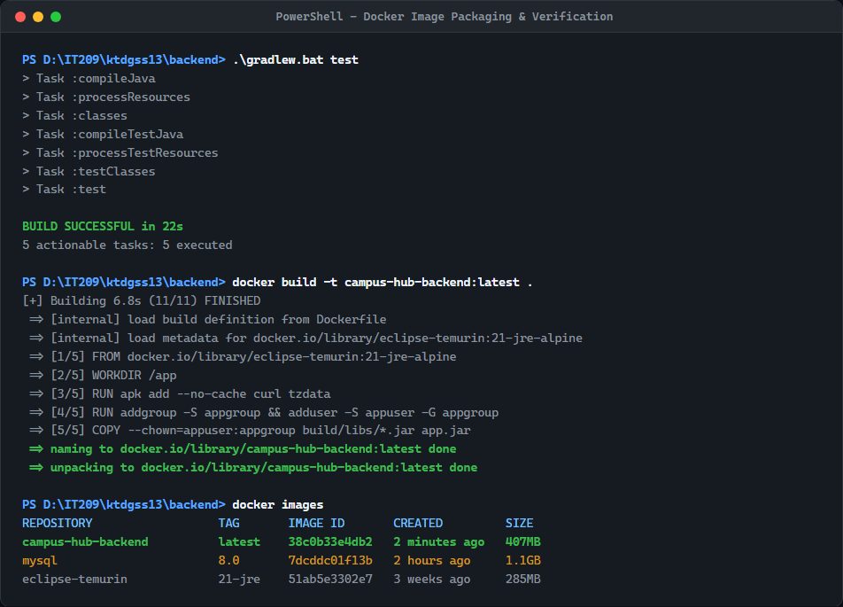
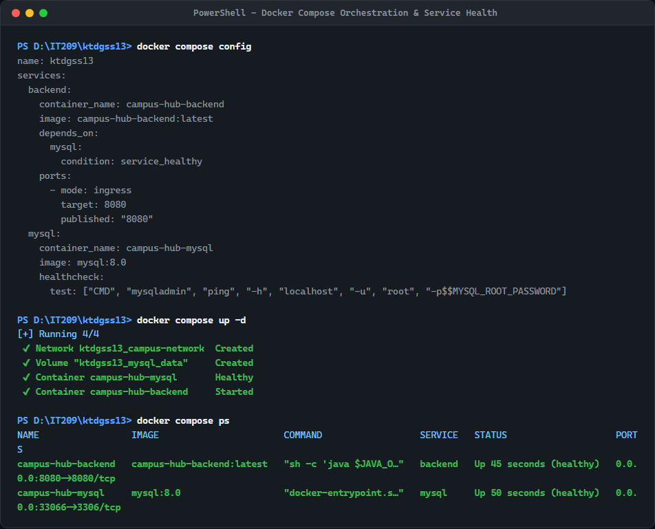
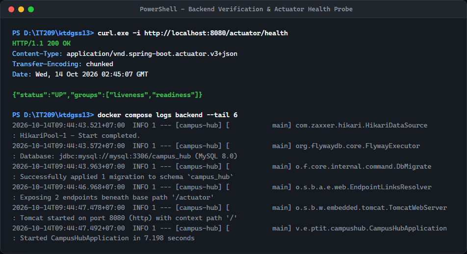

# Bài Kiểm Tra Đầu Giờ: Đóng Gói Và Chạy Campus Hub Với Docker

> **Học phần:** IT209 — DevOps & Kỹ Thuật Vận Hành Hệ Thống  
> **Đơn vị:** Học viện Công nghệ Bưu chính Viễn thông (PTIT)  
> **Dự án sử dụng:** Campus Hub Base  

---

## 👨‍🎓 1. Thông Tin Sinh Viên

- **Họ và tên:** Nguyễn Việt Nam


## 🚀 2. Hướng Dẫn Thực Thi Hệ Thống

### Bước 1: Kiểm thử Backend với Gradle
```powershell
cd backend
./gradlew.bat test
cd ..
```
*Kết quả:* Toàn bộ unit/integration test chạy thành công (`BUILD SUCCESSFUL`).

### Bước 2: Đóng gói Backend thành Docker Image
```powershell
# Build Docker image từ thư mục backend
docker build -t campus-hub-backend:latest ./backend

# Kiểm tra Docker Image vừa build trong danh sách
docker images | grep campus-hub-backend
```

### Bước 3: Khởi chạy hệ thống Backend & MySQL với Docker Compose
```powershell
# Kiểm tra tính hợp lệ của file cấu hình Compose
docker compose config

# Khởi chạy toàn bộ hệ thống ở chế độ background
docker compose up -d

# Kiểm tra trạng thái hoạt động của các service
docker compose ps
```

### Bước 4: Kiểm tra Healthcheck của Backend
```powershell
curl http://localhost:8080/actuator/health
```

---

## 🌐 3. Thông Tin Cổng & Địa Chỉ Truy Cập Dịch Vụ

| Dịch vụ | Container Name | Cổng Host (Công khai) | Cổng Nội bộ | URL / Địa chỉ kiểm tra |
|---|---|---|---|---|
| **Backend Campus Hub** | `campus-hub-backend` | `8080` | `8080` | `http://localhost:8080/actuator/health` |
| **MySQL Database** | `campus-hub-mysql` | `3306` | `3306` | `mysql://localhost:3306/campus_hub` |

*Ghi chú về kết nối CSDL:* Backend kết nối tới MySQL thông qua mạng nội bộ Docker (`campus-network`) với URL:  
`jdbc:mysql://mysql:3306/campus_hub?createDatabaseIfNotExist=true&useSSL=false&allowPublicKeyRetrieval=true&serverTimezone=Asia/Ho_Chi_Minh`  
(Sử dụng tên service `mysql` thay cho `localhost` theo đúng yêu cầu đề bài).

---

## 🛠️ 4. Kiến Trúc & Cấu Hình Đóng Gói

### 4.1. Cấu trúc Multi-stage Dockerfile (`backend/Dockerfile`)
- **Stage 1 (Builder):** Sử dụng `eclipse-temurin:21-jdk-alpine` để biên dịch ứng dụng bằng Gradle Wrapper, tận dụng Docker cache cho dependencies và Gradle wrapper.
- **Stage 2 (Runner):** Sử dụng `eclipse-temurin:21-jre-alpine` siêu nhẹ, giảm tối đa kích thước image.
- **Bảo mật:** Tạo và chạy dưới tài khoản non-root `appuser:appgroup`.
- **Tối ưu hóa JVM:** Cấu hình `-XX:+UseContainerSupport -XX:MaxRAMPercentage=75.0` tương thích container.
- **Healthcheck tích hợp:** Định kỳ gọi `/actuator/health` bằng `curl`.

### 4.2. File `.dockerignore` (`backend/.dockerignore`)
Loại bỏ triệt để các thư mục và tệp không cần thiết giúp tối ưu dung lượng build context và tăng tốc độ build:
- `.gradle/`, `build/` (cache và artifact build cục bộ).
- `.git/`, `.gitignore` (lịch sử và cấu hình git).
- `.idea/`, `*.iml`, `.vscode/` (cấu hình IDE).
- `*.log` (file log tạm thời).

### 4.3. Cấu hình Docker Compose (`docker-compose.yml`)
- Tách biệt rõ ràng 2 service: `mysql` (MySQL 8.0) và `backend` (Campus Hub Spring Boot).
- Sử dụng bridge network chuyên dụng `campus-network`.
- Lưu trữ dữ liệu MySQL bền vững qua named volume `mysql_data`.
- Áp dụng cơ chế **Healthcheck Dependency**: `backend` chỉ khởi động khi `mysql` đã đạt trạng thái `healthy` (`service_healthy`), ngăn ngừa triệt để lỗi từ chối kết nối khi MySQL khởi tạo lần đầu.
- Quản lý cấu hình linh hoạt thông qua biến môi trường (`.env` / `.env.example`).

---

## 📸 5. Minh Chứng Kết Quả Thực Hiện

### Minh chứng 1: Docker Image Đã Build Thành Công
Image `campus-hub-backend` được build hoàn tất và hiển thị trong danh sách `docker images`:



---

### Minh chứng 2: Trạng Thái Các Service Hoạt Động (Docker Compose PS)
Cả hai service `campus-hub-mysql` và `campus-hub-backend` đều ở trạng thái `Up (healthy)`:



---

### Minh chứng 3: Kết Quả Gọi Endpoint `/actuator/health`
Endpoint `/actuator/health` trả về mã HTTP `200 OK` cùng trạng thái `{"status":"UP"}`:



---

## 🧹 6. Lệnh Dọn Dẹp Môi Trường (Khi Cần)

```powershell
# Dừng và xóa containers, network
docker compose down

# Dừng và xóa kèm volume dữ liệu (nếu muốn reset database)
docker compose down -v
```
